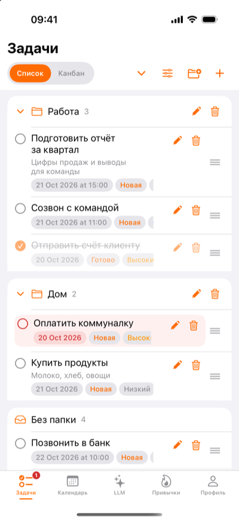
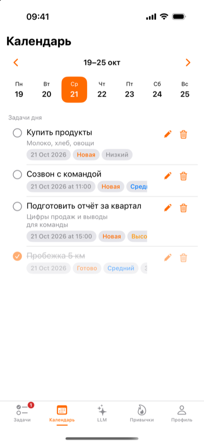
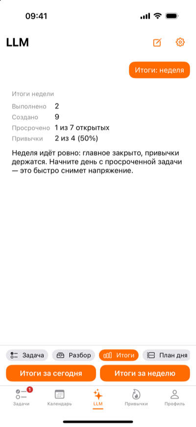
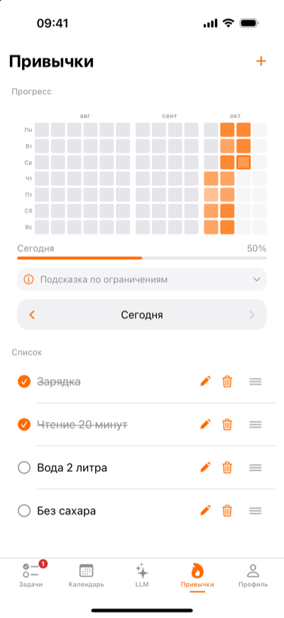
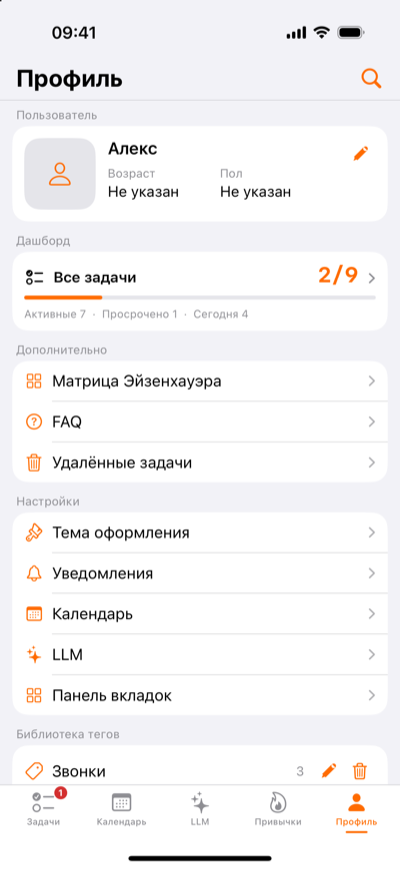

# BraineeApp

**Личный «второй мозг» для iPhone: задачи, привычки и необязательный ИИ-помощник. Offline-first — все данные остаются на устройстве.**


[English version](README.md)

| Задачи | Календарь | ИИ-помощник | Привычки | Профиль |
|:---:|:---:|:---:|:---:|:---:|
|  |  |  |  |  |

Скриншоты — на демо-данных.

## Возможности

- **Задачи** — срок с временем или без, приоритеты, статусы, описание, теги, папки, перетаскивание, список и канбан, мягкое удаление с корзиной.
- **Календарь** — неделя и задачи выбранного дня; по желанию — односторонний экспорт в собственный календарь «BraineeApp» в Календаре iPhone (iCloud) и список встреч дня из ваших календарей (только просмотр, по времени, с началом и продолжительностью).
- **Привычки** — до 7 штук, сетка прогресса за три месяца, отметки за сегодня и до 14 дней назад.
- **ИИ-помощник (необязательно, OpenRouter)** — задача из фразы, разбор длинного текста на несколько черновиков, короткие итоги дня или недели, план на сегодня. Черновик сохраняется только после подтверждения в обычной форме задачи.
- **Дашборд** — прогресс, просроченные и задачи на сегодня; детализация с круговой диаграммой по тегам (легенда в %) и переключателем «Активные / Все» (включая корзину).
- **Матрица Эйзенхауэра** — квадранты по приоритету и срочности.
- **Напоминания и наклейка** — локальные уведомления о задачах и привычках, о сроках, настраиваемый счётчик на иконке.
- **Виджеты** — задачи на сегодня, привычки, дашборд (S / M / L).
- **Резервная копия** — экспорт в один JSON-файл через «Файлы», ежедневный автобэкап (7 последних копий), восстановление «заменить всё» с сохранением текущего состояния.
- **Оформление** — светлая и тёмная тема, акцентные цвета с иконками приложения, настраиваемая панель вкладок.

## Конфиденциальность

- Все данные — в локальном хранилище SwiftData на устройстве. Без аккаунта, аналитики и синхронизации данных через iCloud.
- ИИ-помощник выключен, пока вы не добавите свой ключ [OpenRouter](https://openrouter.ai). Ключ хранится в Keychain только этого устройства.
- Запросы уходят только по вашему действию, по одному, без истории чата:

| Режим | Что отправляется |
|---|---|
| Задача / Разбор | ваш текст, сегодняшняя дата, часовой пояс, названия ваших папок и тегов |
| Итоги | только числа (выполнено, создано, просрочено, отметки привычек) — без названий |
| План дня | названия, приоритеты, время срока и признак просрочки задач на сегодня и просроченных (до 30) — с однократным согласием |

Описания задач, данные профиля и бэкапы не отправляются никогда.

## Технологии

| Область | Технология |
|---|---|
| Интерфейс | SwiftUI |
| Хранение | SwiftData (версионированная схема, постоянное хранилище в Application Support) |
| Бэкап | JSON через «Файлы» |
| Календарь | EventKit (односторонний экспорт, просмотр встреч) |
| ИИ | OpenRouter Chat Completions через `URLSession` |
| Секреты | Keychain |
| Виджеты | WidgetKit + App Group |
| Уведомления | UserNotifications |
| Тесты | Swift Testing — 329 юнит-тестов |
| Зависимости | нет (только Apple SDK) |

## Архитектура

Экраны SwiftUI читают данные через `@Query`; любое изменение идёт через сервисы `Domain/`, после чего в одном месте выполняются побочные эффекты: сохранение, виджеты, уведомления, экспорт в Календарь. Интеграции (EventKit, OpenRouter) лежат в `Integrations/` и не получают права менять хранилище. Подробно — [`docs/ARCHITECTURE.md`](docs/ARCHITECTURE.md), решения и их причины — [`docs/decisions.md`](docs/decisions.md).

## Запуск

**Нужно:** macOS с Xcode 16.2 или новее, симулятор или устройство с iOS 18.2+.

1. Склонировать репозиторий и открыть `BraineeApp.xcodeproj`.
2. Выбрать схему **BraineeApp** и симулятор или своё устройство.
3. Для устройства указать свою команду в *Signing & Capabilities* (приложение и виджет используют общую App Group).
4. Собрать и запустить (⌘R).
5. По желанию — добавить ключ OpenRouter в «Профиль → Настройки → LLM».

Попробовать на демо-данных в симуляторе (Debug-сборка): запуск с аргументом `-SeedDemoData`, а с `-LLMStub` помощник работает без ключа — см. [`docs/TESTING.md`](docs/TESTING.md).

## Тесты

```bash
scripts/test.sh                  # все юнит-тесты
scripts/test.sh TaskServiceTests # выбранные наборы
scripts/test.sh --build          # только сборка
```

Подробно — [`docs/TESTING.md`](docs/TESTING.md), ручные сценарии — [`docs/manual-test-scenarios.md`](docs/manual-test-scenarios.md).

## Структура репозитория

```
BraineeApp/            приложение: Views, Domain, Models, Persistence, Integrations, Utilities
BraineeAppTests/       юнит-тесты (Swift Testing)
BraineeAppUITests/     шаблон UI-тестов Xcode (не используется)
BraineeAppWidget/      расширение виджетов
BraineeShared/         снимок данных для виджетов
docs/                  архитектура, решения, тестирование, скриншоты
scripts/test.sh        компактный запуск тестов
CLAUDE.md              рабочие правила для ИИ-ассистента разработки
```

## Документация

| Документ | Содержание |
|---|---|
| [ARCHITECTURE](docs/ARCHITECTURE.md) | слои, хранение, бэкап, экспорт в Календарь, интеграция с ИИ |
| [Решения](docs/decisions.md) | журнал архитектурных решений D-01…D-36 |
| [Тестирование](docs/TESTING.md) | автотесты, отладочные аргументы запуска, проверки в симуляторе |
| [Ручные сценарии](docs/manual-test-scenarios.md) | пошаговые сценарии приёмки |
| [Changelog](CHANGELOG.md) | история заметных изменений (на английском) |

## Статус

Личный проект: автор делает его и пользуется им сам. Текущий набор функций зафиксирован, дальнейшее развитие — по отдельному бэклогу. В App Store не опубликован. Issues приветствуются, pull requests не ожидаются.

## Лицензия

[GNU General Public License v3.0](LICENSE).

## Автор

Валерий Карцов — [@valeriykartsov](https://github.com/valeriykartsov)
